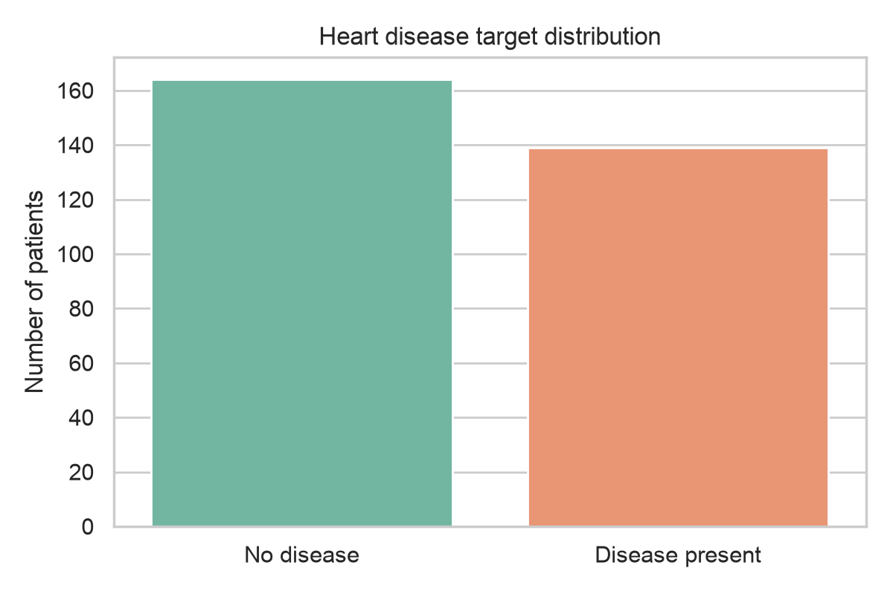
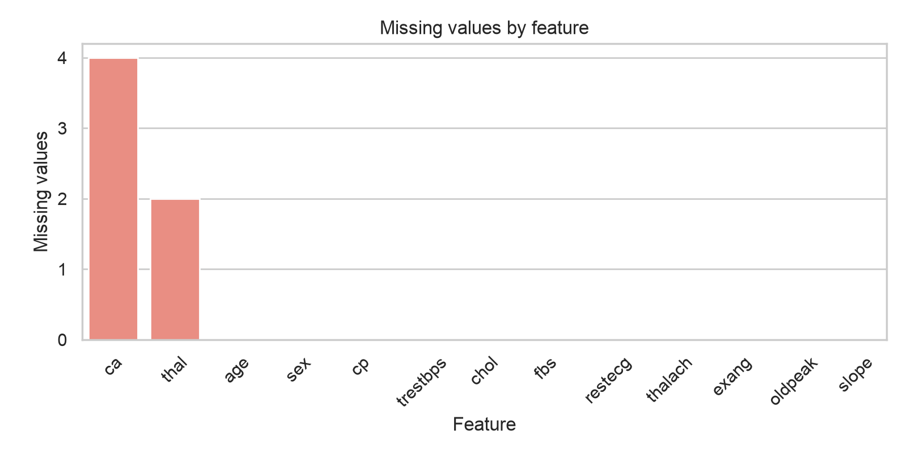
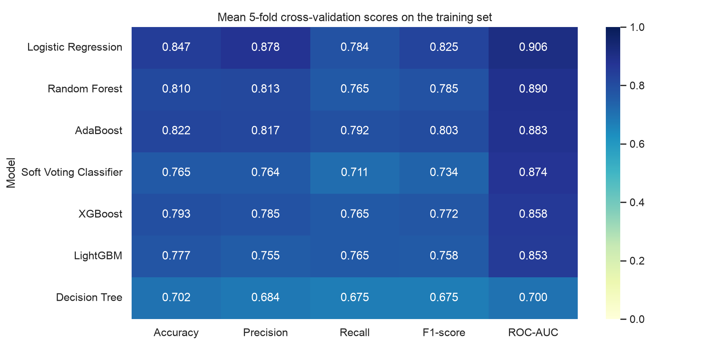
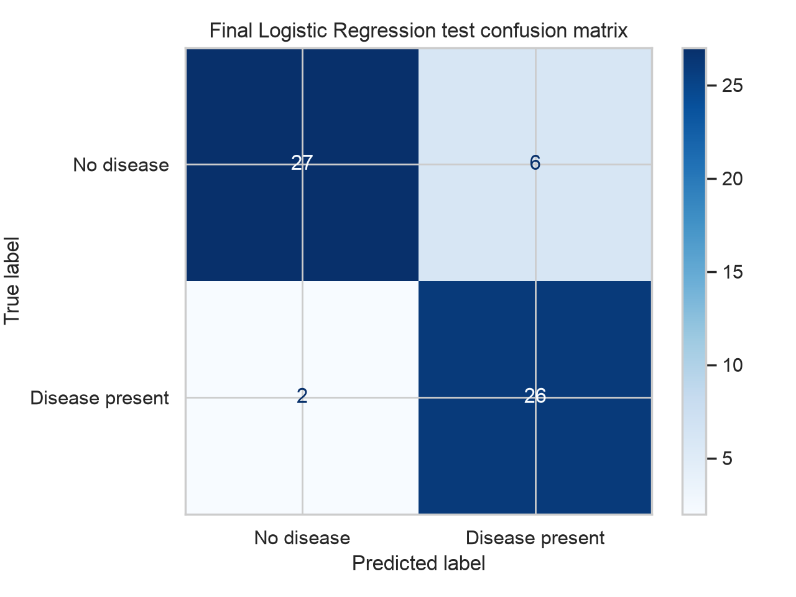
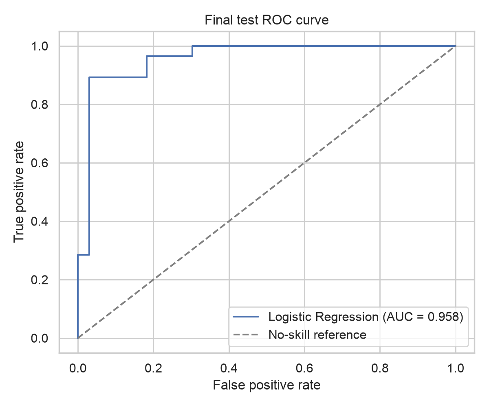

# Early Detection of Heart Disease Risk Using Ensemble Learning

## Purpose

This B.Tech machine learning project builds an understandable, reproducible workflow for classifying the presence of heart disease from clinical attributes. Its central question is whether ensemble models genuinely improve on a simple Logistic Regression baseline for this dataset.

The result is evidence-led: several tree and boosting ensembles were evaluated, but the selected model is Logistic Regression because it performed best and most consistently in cross-validation.

> **Educational use only:** This project is not a clinically validated diagnostic tool. It must not be used to diagnose, treat, or make medical decisions for an individual.

## Problem statement

Develop a machine learning model that uses documented clinical attributes to classify the target supplied by the UCI Heart Disease dataset. Compare an interpretable baseline against individual tree and ensemble methods, then select a final model using more than accuracy alone.

## Deliverables

- A documented Jupyter notebook covering dataset understanding through final model saving.
- Reproducible CSV exports of the imported data and train/test split.
- Cross-validated comparison of seven classifiers.
- A saved preprocessing-and-prediction pipeline.
- Test metrics, predictions, and visual report figures.
- A Python-only Streamlit demonstration that loads the saved pipeline.

## Dataset

**Source:** [UCI Heart Disease Dataset, ID 45](https://archive.ics.uci.edu/dataset/45/heart+disease)

The imported Cleveland subset contains **303 records**, **13 features**, and the target `num`.

- Original target: `num = 0` means no detected heart disease; `num = 1–4` represent presence/severity in the original angiographic diagnosis.
- Modelling target: `0` for `num = 0`; `1` for any `num` value from 1 to 4.
- Missing values: `ca` has 4 missing values and `thal` has 2.

### Features

| Group | Features | Notes |
|---|---|---|
| Numeric measurements | `age`, `trestbps`, `chol`, `thalach`, `oldpeak`, `ca` | Age, blood pressure, cholesterol, heart rate, ST depression, and vessel count. |
| Categorical/binary codes | `sex`, `cp`, `fbs`, `restecg`, `exang`, `slope`, `thal` | These are encoded categories, not continuous quantities. |

## Workflow

1. Inspect official dataset documentation, variables, target values, and missing data.
2. Explore target balance, missingness, numerical distributions, and categorical relationships.
3. Define train-only imputation, one-hot encoding, and scaling in a scikit-learn pipeline.
4. Create a stratified 80/20 train-test split with `random_state=42`.
5. Establish a Logistic Regression baseline using stratified 5-fold cross-validation.
6. Compare Decision Tree, Random Forest, AdaBoost, Soft Voting, XGBoost, and LightGBM candidates.
7. Inspect feature contributions and cross-validated error behaviour.
8. Select the model before accessing the held-out test set.
9. Fit, save, and evaluate the final complete pipeline once on the test set.

## Exploratory findings

The binary modelling target is reasonably balanced: 164 no-disease records (54.1%) and 139 disease-present records (45.9%). Missingness is limited to `ca` and `thal`, so both are imputed inside the pipeline using training data only.





The exploratory analysis showed that the disease-present group had lower maximum heart rate and higher ST depression and vessel count in this sample. These are associations in a small historical dataset, not causal or clinical rules.

## Preprocessing and leakage prevention

The final pipeline applies these transformations only after fitting on training data:

- Numeric features: median imputation, then `StandardScaler`.
- Categorical features: most-frequent-category imputation, then `OneHotEncoder(handle_unknown='ignore')`.
- Target: binary presence/absence definition described above.

Keeping preprocessing inside the pipeline prevents the test partition from influencing imputation, scaling, or category handling.

## Model comparison

All models were evaluated using the same stratified 5-fold cross-validation on the training partition. Values below are mean scores; the complete score and standard-deviation table is available in [cross_validation_model_comparison.csv](reports/cross_validation_model_comparison.csv).

| Model | Accuracy | Precision | Recall | F1-score | ROC-AUC |
|---|---:|---:|---:|---:|---:|
| Logistic Regression | **0.847** | **0.878** | 0.784 | **0.825** | **0.906** |
| Random Forest | 0.810 | 0.813 | 0.765 | 0.785 | 0.890 |
| AdaBoost | 0.822 | 0.817 | **0.793** | 0.803 | 0.883 |
| Soft Voting Classifier | 0.765 | 0.764 | 0.712 | 0.734 | 0.874 |
| XGBoost | 0.793 | 0.785 | 0.765 | 0.772 | 0.858 |
| LightGBM | 0.777 | 0.755 | 0.765 | 0.758 | 0.853 |
| Decision Tree | 0.702 | 0.684 | 0.675 | 0.675 | 0.700 |



## Why Logistic Regression was selected

Logistic Regression achieved the highest ROC-AUC, accuracy, precision, and F1-score, while retaining low fold-to-fold variation. AdaBoost produced slightly higher recall, but with lower ROC-AUC, precision, F1-score, and stability. Random Forest was the closest ensemble competitor, but its ROC-AUC was still lower by 0.016.

This outcome is reasonable for a small dataset: a regularized linear model can generalize better than flexible tree ensembles when the useful relationships are largely additive after preprocessing. Ensemble learning is not guaranteed to outperform a well-matched baseline.

## Final held-out test results

After selection, Logistic Regression was fitted on all 242 training records and evaluated once on the untouched 61-record test set.

| Accuracy | Precision | Recall | F1-score | ROC-AUC |
|---:|---:|---:|---:|---:|
| 0.8689 | 0.8125 | 0.9286 | 0.8667 | 0.9578 |

Class-level test results:

| Class | Precision | Recall | F1-score | Support |
|---|---:|---:|---:|---:|
| No disease | 0.93 | 0.82 | 0.87 | 33 |
| Disease present | 0.81 | 0.93 | 0.87 | 28 |

The high recall for the disease-present class means the final model missed relatively few positive records in this specific test split. It comes with lower precision, meaning some no-disease records were flagged as disease-present. The choice of this trade-off is a clinical-policy question, not something this educational model resolves.





## Repository layout

```text
data/
  raw/heart_disease_original.csv          # Imported UCI data and original target
  processed/train.csv, test.csv           # Reproducible modelling split
notebooks/heart_disease_analysis.ipynb    # End-to-end learning workflow
src/models/train_final_model.py            # Reproducible training and export script
models/heart_disease_logistic_pipeline.joblib
models/heart_disease_logistic_metadata.json
reports/                                  # Metrics, predictions, CSV comparison, and PNG figures
app/app.py                                # Streamlit demonstration
```

## Run the project

```powershell
python -m venv .venv
.\.venv\Scripts\Activate.ps1
python -m pip install -r requirements.txt
python src/models/train_final_model.py
python -m streamlit run app/app.py
```

If `streamlit` is not recognized, always use `python -m streamlit` as shown above; this ensures the command uses the same Python environment where dependencies were installed.

## Saved artifacts

- [Final pipeline](models/heart_disease_logistic_pipeline.joblib)
- [Model metadata](models/heart_disease_logistic_metadata.json)
- [Final test metrics](reports/final_test_metrics.csv)
- [Final test predictions](reports/final_test_predictions.csv)
- [Classification report](reports/final_test_classification_report.txt)
- [Cross-validation results](reports/cross_validation_model_comparison.csv)

## Limitations and responsible use

- The dataset is small, historical, and based on a specific clinical context; it may not generalize to current populations or other hospitals.
- The target reflects angiographic disease status, not a general medical risk score.
- Model performance on one held-out split is uncertain and should not be treated as medical validation.
- Important clinical context is absent from the dataset, and encoded variables can reflect measurement and selection biases.
- This project is appropriate for learning and demonstration, not real patient care.

## Conclusion

This project demonstrates the full machine-learning workflow: documentation review, EDA, leakage-safe preprocessing, fair cross-validation, model comparison, interpretation, selection, model saving, and deployment through Streamlit. The evidence from this dataset supports Logistic Regression as the final model. The result is valuable precisely because it does not assume an ensemble must win: the selected model is the one that best balanced performance, stability, simplicity, and interpretability.
